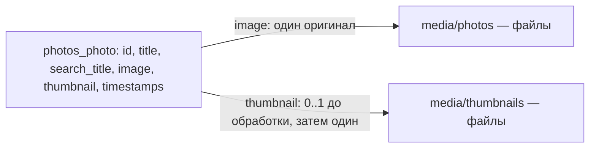

# Физическая модель PostgreSQL

Основная сущность Photo представлена таблицей public.photos_photo. Модель отражает фактические миграции Django; исходный файл и миниатюра не выделяются в самостоятельные SQL-таблицы.

| Поле | Тип PostgreSQL | Правило |
|---|---|---|
| id | bigint identity | NOT NULL, PRIMARY KEY |
| title | varchar(120) | NOT NULL, непустое название проверяет приложение |
| search_title | varchar(360) | NOT NULL, Python casefold от title; длина допускает расширение Unicode |
| image | varchar(100) | NOT NULL, относительное имя исходного файла |
| thumbnail | varchar(100) | NOT NULL, относительное имя миниатюры, до генерации допускается пустая строка |
| created_at | timestamp with time zone | NOT NULL, Django auto_now_add |
| updated_at | timestamp with time zone | NOT NULL, Django auto_now |

Индексы: первичный ключ id; B-tree по search_title и дополнительный varchar_pattern_ops, создаваемый Django для строкового поля. LIKE с ведущим `%` может потребовать полного просмотра; для большого каталога отдельно рассматривается pg_trgm. Автозаполнение времени и search_title выполняет Django, SQL-default для этих полей не задается. Названия не имеют UNIQUE.



Эти связи поддерживает приложение, они не являются SQL FOREIGN KEY. Стандартные таблицы Django auth/session/admin обслуживают вход и администрирование; у Photo нет внешнего ключа владельца, каталог общий.

Запись меняется транзакционно, прежние файлы удаляются после commit. На случай аварии БД и файловую систему резервируют согласованно. Миграции0001–0003 создают сущность и поисковое поле/данные; последующая миграция расширяет search_title до360 символов.

## Наполнение

При первоначальном bootstrap создается запись «Осеннее озеро в горах» из demo/ural-lake.png. Проверка title делает load_demo повторяемой без дублирования. Удаленная демофотография не должна самопроизвольно появляться после обычного перезапуска.

Для дополнительных тестов загрузите через форму «Озеро на рассвете» и «Горный пейзаж». Поиск «ОЗЕРО» должен находить обе записи с озером и исключать пейзаж. Во время интеграционных тестов создаются собственные маленькие PNG, поэтому проверки не зависят от ручных данных.

```sql
SELECT id, title, search_title, image, thumbnail, created_at, updated_at
FROM photos_photo
ORDER BY created_at DESC, id DESC;
```

Прямой INSERT путей не создает изображений и миниатюр. Для наполнения используйте форму, API или management command. Параметры подключения pgAdmin приведены в README.
